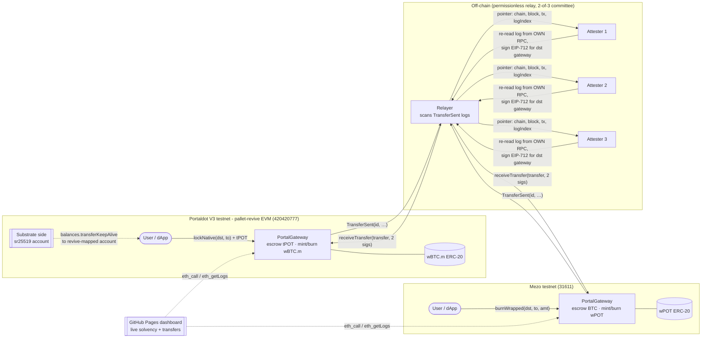
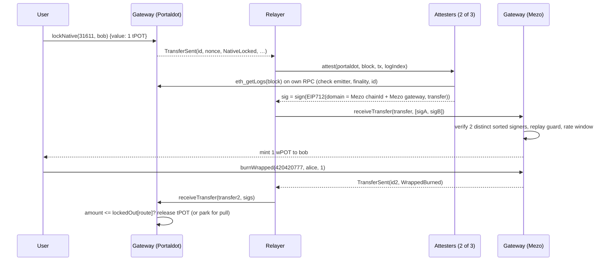

# PortalLink

**A verifiable lock/mint bridge for Portaldot V3.** Lock native **tPOT** on Portaldot (pallet-revive EVM) and receive **wPOT** (ERC-20) on **Mezo testnet**, or go the other way with Mezo **BTC** to **wBTC.m** on Portaldot. A 2-of-3 attester committee approves every transfer, the contracts enforce escrow caps, and a live dashboard proves solvency in your browser.

> Portaldot Hacker House 2026 · **Multi-Chain & Cross-Chain Infra** track · MIT · testnet only

| | |
|---|---|
| Dashboard | https://xachp.github.io/portallink/ (static, reads both chains straight from public RPCs) |
| Mezo testnet (31611) | PortalGateway [`0xA86c25550eb58B6c7FB3cd4350CEBFd0FA9801FB`](https://explorer.test.mezo.org/address/0xA86c25550eb58B6c7FB3cd4350CEBFd0FA9801FB) · wPOT [`0x0B4a82bCD88FA31cB71E895290251f855f6ABbfc`](https://explorer.test.mezo.org/address/0x0B4a82bCD88FA31cB71E895290251f855f6ABbfc) · both verified on Sourcify |
| Portaldot V3 testnet (420420777) | _pending hackathon tPOT faucet_: `scripts/portaldot-go-live.sh` deploys + links + runs the live round trip in one go |
| Tests | 49 Foundry tests (unit, fuzz, stateful invariant) + 8 relayer tests · CI in `.github/workflows/ci.yml` |

## Why Portaldot needs this

Portaldot V3 runs two contract VMs (WASM `contracts` and EVM-compatible `revive`) and lists cross-chain interoperability ("iBridge") as a V3 pillar. Today:

* no bridge pallet (XCM / ISMP / iBridge) is live on the V3 testnet;
* the official FAQ says no adapter exists between revive ERC-20s and other assets, and that cross-chain/atomic paths are "awaiting confirmation";
* the eth-rpc prunes old receipts and there is no EVM explorer, so other teams cannot easily *prove* what happened on-chain.

PortalLink is the missing piece: a small, auditable message-and-asset gateway that works on revive **as it exists today**, plus tooling built around revive's quirks (account mapping, storage deposits, pruned receipts).

## Architecture



Transfer lifecycle (tPOT to wPOT, then back):



### Contracts (`src/`)

| Contract | Size | Role |
|---|---|---|
| `PortalGateway.sol` | 9.9 KB | One per chain. `lockNative` / `burnWrapped` (outbound), `receiveTransfer` (inbound, attested), routes, limits, pause, pull-payouts |
| `AttesterSet.sol` | (abstract) | M-of-N ECDSA committee: EIP-712 domain (chain id + contract), low-s, strictly ascending signers, majority threshold, self-governed rotation with epochs |
| `WrappedToken.sol` | 2.2 KB | Minimal ERC-20, mint/burn only by its bound gateway, records `originChainId` |

Design points:

* **Same transfer id on both chains.** `id = EIP-712 struct hash`, emitted on the source and stored in `processed[id]` on the destination, so anyone can join the two sides.
* **Signatures bound to the destination.** The domain includes `block.chainid` and the gateway address, so a signature can't be replayed to another chain or another gateway.
* **Escrow cap even if the committee is compromised.** A release can never exceed `lockedOut` for that route. A malicious 2-of-3 cannot drain more than what users bridged through that route.
* **Per-asset limits.** Each route has separate `native` and `wrapped` limits (tPOT and BTC differ by about 10⁸ in value): min, max per transfer, and a 24h inbound cap.
* **Liveness.** If a recipient's receive reverts, the payout is parked in `owed[...]`, so one hostile recipient can't block the queue.
* **Roles.** The guardian can pause; only the admin can unpause. Admin transfer is 2-step and peers are write-once.
* **Revive-friendly.** Small bytecode (`bytecode_hash=none`, no CBOR metadata, shanghai target), because revive charges about 0.06 tPOT per byte. There's no `CREATE` from contracts, so deployment is identical on revive and standard EVMs.

### Off-chain (`relayer/`)

| File | What it does |
|---|---|
| `attester.mjs` | Gets only a *pointer* from the relayer and re-reads the log itself. Checks the emitter, finality depth and that the id matches the fields, then signs. Runs in-process or as an HTTP service (`--serve`), one per operator |
| `relayer.mjs` | Chunked `eth_getLogs` scan per chain with a persisted cursor. Skips processed ids, sorts signatures, submits, and writes `docs/data/*-feed.json` |
| `deploy.mjs` | Deploys token + gateway, binds, then links routes with per-asset limits. Can resume after a crash |
| `portaldot-fund.mjs` | Substrate side (`@polkadot/api`): resolves the EVM key's revive-mapped `AccountId32` via `reviveApi.accountId` and moves faucet tPOT to it |
| `user.mjs`, `status.mjs` | Lock/burn CLI, and a solvency check (exit code 2 if any wrapped supply isn't fully backed) |

Portaldot/Mezo quirks handled (useful to every team):

* Portaldot's eth-rpc prunes old receipts, so attesters use `eth_getLogs` by block.
* Mezo receipts have no `effectiveGasPrice`, so ethers' `tx.wait()` hangs forever. We poll raw receipts instead.
* Native tPOT has 14 decimals and the EVM view uses 18.
* The existential deposit is 0.1 tPOT, so the minimum transfer is 0.2.

## Run it locally (2 minutes, no tokens needed)

```bash
git clone --recursive https://github.com/XachP/portallink && cd portallink
forge test                          # 49 tests
(cd relayer && npm ci && npm test)  # 8 tests
./scripts/local-e2e.sh              # two anvil chains (420420777 + 31611): deploy, link, relay,
                                    # lock 25 tPOT -> wPOT, burn 10 -> tPOT, lock BTC -> wBTC.m,
                                    # then a solvency check
```

Expected tail:

```
local-portaldot -> local-mezo: escrowed 15 tPOT | wPOT on local-mezo: 15 wPOT | FULLY BACKED
local-mezo -> local-portaldot: escrowed 0.005 BTC | wBTC.m on local-portaldot: 0.005 wBTC.m | FULLY BACKED
```

## Deploy to the testnets

Prereqs: Foundry, Node 20+, and three JSON key files (never commit them):

* the Portaldot EVM deployer (`{"evm":{"privateKey":…}}`, plus the native sr25519 mnemonic for funding);
* the Mezo deployer;
* the attester committee (`{"attesters":[{"privateKey":…},…]}`).

1. **Get tPOT.** There's no public faucet. Open a ticket in the Portaldot Discord with your native `5…` address.
2. **Mezo side** (already live, see the table above):
   ```bash
   cd relayer
   ATTESTER_KEYS=… node deploy.mjs --network mezo-testnet --remote portaldot-testnet --key-file <mezo key>
   ```
3. **Portaldot side, linking, and the live demo**, all in one command once tPOT arrives:
   ```bash
   WALLET_DIR=<dir with key files> ./scripts/portaldot-go-live.sh --wait
   ```
   This moves tPOT from the sr25519 account to the EVM deployer's revive-mapped account, deploys `wBTC.m` and `PortalGateway` (about 1,030 tPOT of storage deposit, measured with `eth_estimateGas`), links both gateways, and relays three live transfers.
4. **Keep relaying:**
   ```bash
   RELAYER_KEY_FILE_PORTALDOT_TESTNET=… RELAYER_KEY_FILE_MEZO_TESTNET=… ATTESTER_KEYS=… \
     node relayer.mjs --profile testnet
   ```
   For separate operators, run `node attester.mjs --serve --index i` on each machine and set `ATTESTER_URLS`.
5. **Dashboard:** `node relayer/export-config.mjs`, then serve `docs/` (GitHub Pages from `/docs`).

Network facts (probed live): Substrate `wss://test-node-v3.portaldot.dev`, EVM `https://test-evm-rpc-v3.portaldot.dev`, chainId 420420777, token tPOT (14 dec), node console https://node-console.portaldot.dev. Mezo `https://rpc.test.mezo.org`, chainId 31611.

## Security

See [THREAT_MODEL.md](THREAT_MODEL.md). The short version: this is a **committee bridge**. It is honest about its trust assumption (2-of-3), and it limits the damage if that assumption fails (escrow caps, rate windows, pause). It is not audited. It is for testnets only.

## Roadmap

* **WASM lane:** an ink! endpoint in Portaldot's `contracts` VM talking to the revive gateway through the same attested messages (no synchronous ink!↔Solidity path exists today).
* **pallet-assets lane:** lock native Assets (ids 1, 2, …) on the Substrate side with a `pallet-multisig` custody that uses the same committee, and mint ERC-20 on revive.
* Per-operator attesters on separate infra, a slashing bond, and a timelocked admin.
* Swap the committee for BEEFY light-client proofs once Portaldot publishes them (`beefy` and `mmr` pallets are already in the runtime).

## Development log

See [DEVLOG.md](DEVLOG.md). Built during the Hacker House (Oct 14 – Nov 6, 2026). Open-source dependencies: forge-std (MIT/Apache-2.0), ethers v6 (MIT), @polkadot/api (Apache-2.0).
